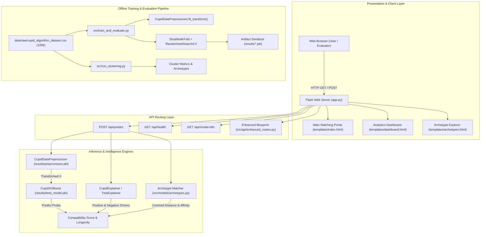
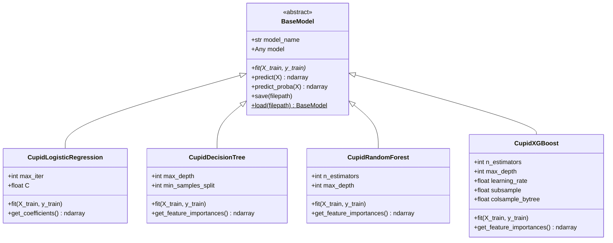
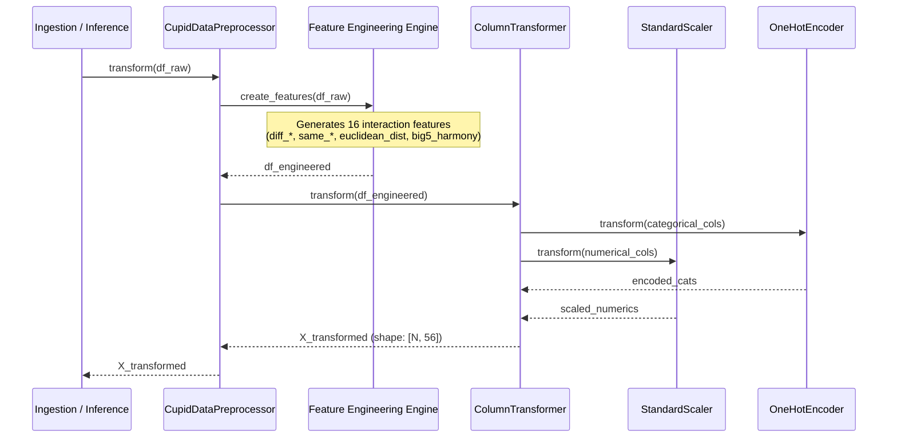

# 🏛️ Architecture Documentation — Cupid AI System

> **Document Type:** Technical System & Software Architecture Blueprint  
> **System Name:** Cupid AI Matchmaking & Personality Analytics Engine  
> **Design Pattern:** Object-Oriented Domain Layer with Scikit-Learn Transformers & Flask Microservice  
> **Status:** Enhancement Addition (Strictly Non-Destructive)

---

## 1. High-Level System Architecture

Cupid AI is designed as a decoupled, multi-tiered architecture that separates **raw data ingestion**, **feature engineering**, **supervised predictive inference**, **unsupervised clustering**, **interpretability (SHAP)**, and **client-facing presentation layers**.

---

## 2. Object-Oriented Class Hierarchy

The modeling core utilizes an Object-Oriented Programming (OOP) hierarchy adhering to the **Open/Closed Principle** and **Interface Segregation**:

### 2.1 Model Base Contract (`src/models/base_model.py`)
All classification algorithms inherit from `BaseModel`. This ensures that downstream serving scripts, the Flask API, cross-validation runners, and SHAP explainers interact with a consistent interface regardless of the underlying algorithm (`predict()`, `predict_proba()`, `save()`, `load()`).

---

## 3. Preprocessing Pipeline Architecture

The preprocessing architecture encapsulates domain-specific logic, feature engineering, and statistical normalization inside `CupidDataPreprocessor`:

---

## 4. API Endpoints Specification

| Method | Endpoint | Description | Request Body / Parameters | Response Structure |
|---|---|---|---|---|
| `GET` | `/` | Serves main Glassmorphism matchmaking web application | None | HTML document (`templates/index.html`) |
| `GET` | `/dashboard` | Serves Model Performance & Benchmark Dashboard | None | HTML document (`templates/dashboard.html`) |
| `GET` | `/archetypes` | Serves Personality Archetype Explorer & Quiz | None | HTML document (`templates/archetypes.html`) |
| `POST` | `/api/predict` | Computes compatibility prediction, longevity, and SHAP drivers | JSON payload with 26 dyadic profile attributes | `{"success": true, "compatibility_score": 88.5, "compatible": 1, "estimated_longevity_months": 84, "archetype_a": {...}, "xai_breakdown": {...}}` |
| `GET` | `/api/health` | Service health status and artifact verification | None | `{"status": "healthy", "model_loaded": true, "preprocessor_loaded": true}` |
| `GET` | `/api/model-info` | Returns model hyperparameters and benchmark test metrics | None | `{"model_name": "Tuned XGBoost", "metrics": {...}, "best_params": {...}}` |
| `GET` | `/api/model-comparison` | Comparative metrics across all 5 evaluated algorithms | None | `{"models": [{"Model": "XGBoost", "Accuracy": 0.7265, ...}]}` |
| `GET` | `/api/archetypes` | Centroids, names, and trait distributions for all 4 archetypes | None | `{"archetypes": [{"id": 0, "name": "...", "traits": {...}}]}` |

---

## 5. Security & Robustness Considerations

1. **Input Validation:** Required numerical and categorical fields are validated on `/api/predict`. Missing or out-of-range keys trigger explicit `400 Bad Request` messages without crashing the server.
2. **Graceful Fallback:** If serialized pickle artifacts are unavailable, `app.py` falls back to a deterministic heuristic compatibility model based on normalized Euclidean trait distance.
3. **In-Memory Caching:** Heavy machine learning models (`best_model.pkl`, `preprocessor.pkl`, `TreeExplainer`) are loaded once during Flask bootstrap into global state, preventing per-request disk I/O bottlenecks.
