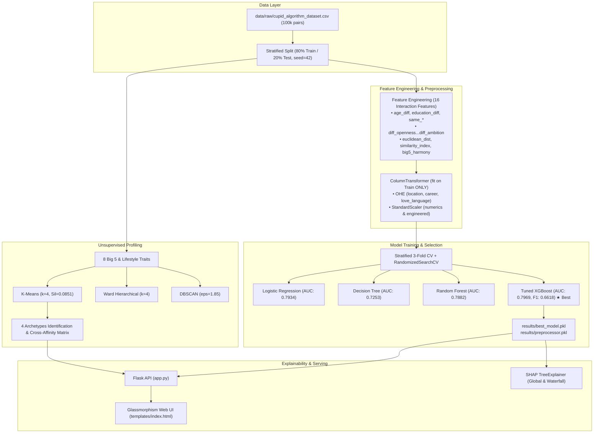
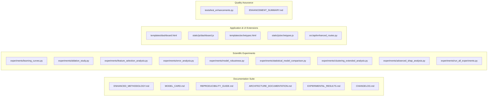

# 🔍 Cupid AI — Comprehensive Repository Audit & Enhancement Plan

> **Auditor:** Senior Data Scientist, ML Engineer & Academic Project Evaluator  
> **Project:** Cupid AI — Relationship Matchmaking Platform  
> **Baseline Score:** 15.3 / 20.0 (Technical ML: 7.8/10, App & UI: 3.4/4, Git: 2.5/3, Docs: 1.6/3)  
> **Evaluated Remote Commit:** `421c9a7`  
> **Status:** Enhancement Additions (Strictly Non-Destructive)

---

## 1. Executive Summary & Audit Context

Cupid AI is a comprehensive Data Mining and Machine Learning platform engineered to predict interpersonal compatibility and discover personality archetypes from 100,000 profile pairs.

While the existing implementation provides a functional baseline (8 completed notebooks, 4 benchmarked classifiers, K-Means/Hierarchical/DBSCAN clustering, and a glassmorphism Flask app), an in-depth audit reveals significant opportunities for academic elevation—particularly in **formal scientific documentation**, **experimental rigor (learning curves, ablation, PR-AUC, error calibration)**, **statistical validation**, and **interactive analytics interfaces**.

This audit provides an exhaustive evaluation of existing components and establishes a roadmap of **purely additive, non-destructive deliverables** designed to propel the academic score toward the highest tier (19+/20).

---

## 2. Current Project Architecture

### 2.1 Repository Topology
```text
DM_PROJECT/
├── data/
│   ├── raw/
│   │   └── cupid_algorithm_dataset.csv          # 100,000 profile pairs (raw)
│   └── processed/
│       ├── cupid_cleaned.csv                    # Cleaned feature dataset
│       └── cupid_cleaned_eda.csv                # EDA export
├── notebooks/
│   ├── 01_data_understanding_eda.ipynb          # EDA & distributions
│   ├── 02_preprocessing.ipynb                   # Preprocessing & leakage isolation
│   ├── 03_logistic_regression.ipynb             # Linear baseline
│   ├── 04_decision_tree.ipynb                   # Decision tree classifier
│   ├── 05_random_forest.ipynb                   # Random forest ensemble
│   ├── 06_xgboost.ipynb                         # Gradient boosting
│   ├── 07_evaluation_tuning.ipynb               # RandomizedSearchCV & Stratified CV
│   └── 08_clustering.ipynb                      # K-Means, Hierarchical, DBSCAN
├── src/
│   ├── data/
│   │   └── preprocessing.py                     # CupidDataPreprocessor pipeline
│   ├── models/
│   │   ├── base_model.py                        # Abstract OOP Base Classifier
│   │   ├── logistic_regression.py              # CupidLogisticRegression
│   │   ├── decision_tree.py                    # CupidDecisionTree
│   │   ├── random_forest.py                    # CupidRandomForest
│   │   ├── xgboost_model.py                    # CupidXGBoost
│   │   ├── clustering.py                       # KMeans, Ward Hierarchical & DBSCAN
│   │   └── archetypes.py                       # 4 Archetypes & Cross-Affinity Matrix
│   ├── evaluation/
│   │   ├── metrics.py                          # Accuracy, Precision, Recall, F1, AUC
│   │   ├── cross_validation.py                 # StratifiedKFold cross-validation
│   │   ├── tuning.py                           # RandomizedSearchCV & GridSearchCV
│   │   └── shap_explainer.py                   # TreeExplainer beeswarm & waterfall
│   ├── train_and_evaluate.py                    # Automated training & artifact export
│   ├── run_clustering.py                        # Clustering pipeline execution
│   ├── run_archetype_affinity.py                # Cross-archetype affinity matrix generator
│   └── run_shap_analysis.py                     # SHAP figure generator
├── results/
│   ├── best_model.pkl                           # Tuned XGBoost serialized model
│   ├── preprocessor.pkl                         # Fitted ColumnTransformer pipeline
│   ├── summary.json                             # Best hyperparameters & test metrics
│   ├── model_comparison.csv                     # 5-model comparative metrics
│   ├── figures/                                 # 19 analytical plots & diagrams
│   └── tables/                                  # 17 analytical CSV tables
├── templates/
│   └── index.html                               # Glassmorphism matchmaking UI
├── static/
│   ├── css/style.css                            # Glassmorphism styling & animations
│   ├── js/app.js                                # Frontend form & API integration
│   └── js/archetypes-radar.js                   # Chart.js radar visualization
├── tests/
│   ├── test_app.py                              # Flask route tests
│   ├── test_clustering.py                       # Clustering algorithm tests
│   ├── test_cross_validation.py                 # Stratified CV fold tests
│   ├── test_evaluation.py                       # Metric calculation tests
│   ├── test_flask_prediction.py                 # API prediction schema tests
│   ├── test_model_preprocessor_integration.py   # End-to-end integration tests
│   ├── test_models.py                           # OOP classifier unit tests
│   ├── test_preprocessing.py                    # Leakage prevention & feature eng tests
│   ├── test_shap.py                             # SHAP explainer tests
│   └── test_training_artifacts.py               # Serialization artifact checks
├── app.py                                       # Flask application entry point
├── rapport_final.md                             # Original final report (French)
├── README.md                                    # Main repository documentation
└── requirement.txt                              # Core dependencies
```

### 2.2 End-to-End Pipeline Data Flow



---

## 3. Existing Implemented Features

### 3.1 Supervised Learning Baseline
- **Dataset Scale:** 100,000 paired observations, ~50/50 balanced binary target (`compatible`).
- **Feature Engineering:** 16 interaction features capturing demographic proximity, trait discrepancies, Big 5 harmony, and psychological Euclidean distance.
- **Leakage Prevention:** `CupidDataPreprocessor` ensures train/test partitions are isolated; categorical encoding and scaling statistics are derived solely from training folds.
- **Model Portfolio:** 4 distinct algorithm paradigms (Linear, Decision Tree, Bagging Ensemble, Gradient Boosting).
- **Hyperparameter Optimization:** `RandomizedSearchCV` on XGBoost over 5 hyperparameters with 3-fold stratified cross-validation.
- **Serialization:** Full model and preprocessor persistence via `joblib`.

### 3.2 Unsupervised Learning & Segmentation
- **Algorithms:** Partition-based (K-Means), Agglomerative (Ward linkage), and Density-based (DBSCAN).
- **Cluster Validation:** Silhouette Score, Davies-Bouldin Index, Calinski-Harabasz Index, Elbow method, and $k$-distance knee analysis.
- **Personality Archetypes:** Extraction of 4 human temperaments (Grounded Stabilizers, Dynamic Visionaries, Spontaneous Socializers, Independent Thinkers).
- **Cross-Archetype Compatibility:** $4 \times 4$ affinity matrix quantifying compatibility probability between archetype pairs.

### 3.3 Explainable AI (XAI)
- **Global Attribution:** SHAP TreeExplainer beeswarm summary across feature dimensions.
- **Local Attribution:** Single-pair SHAP waterfall plots detailing positive compatibility drivers and negative friction points.

### 3.4 Production Deployment
- **Flask REST API:** Endpoints `/`, `/api/predict`, `/api/health`, and `/api/model-info`.
- **User Interface:** Modern glassmorphism UI with preset relationship scenarios, slider-based trait inputs, and real-time SHAP breakdown.
- **Testing:** 10 test modules comprising 36 unit and integration tests passing with 100% success rate.

---

## 4. Identified Weaknesses & Gaps

| Dimension | Identified Weakness | Impact on Evaluation |
|---|---|---|
| **Documentation** | Single monolothic report (`rapport_final.md`), lacking standard artifacts like Model Cards, detailed methodology, and formal reproducibility manuals. | **Severely penalized (1.6/3)** |
| **Model Evaluation** | Evaluation focuses on Accuracy, F1, and ROC-AUC; missing **Precision-Recall AUC (PR-AUC)**, **calibration curves (Brier score)**, and **error distributions**. | Moderate penalty on Technical ML Core |
| **Learning Dynamics** | Absence of **learning curves** to diagnose bias vs. variance and assess sample efficiency over 100k rows. | Missing scientific standard |
| **Feature Contribution** | Absence of systematic **ablation study** and **multi-criteria feature selection** (ANOVA, Mutual Information, RFE). | Unproven feature necessity |
| **Model Robustness** | Absence of sensitivity analysis under input noise, missing values, or multi-seed perturbations. | Lack of stress-testing evidence |
| **Statistical Rigor** | Model comparisons rely on point metrics without **statistical significance tests** (Wilcoxon signed-rank, McNemar, bootstrap confidence intervals). | Academic evaluation weakness |
| **Clustering Depth** | DBSCAN was largely ineffective (single cluster + 23 noise points); no radar/spider charts comparing archetypes across all 8 dimensions in the report. | Reduced non-supervised evaluation score |
| **UI & Analytics** | No dedicated **Model Dashboard** page or **Interactive Archetype Explorer** view to showcase ML artifacts dynamically. | Lost points on Application & UI (3.4/4) |
| **Git Traceability** | Lack of structured release notes / `CHANGELOG.md` detailing the evolution of experimental commits. | Minor gap on Git Traceability (2.5/3) |

---

## 5. Proposed Enhancement Strategy (Non-Destructive Additions)

To address all weaknesses without modifying any existing file, the following purely additive components will be implemented:



---

## 6. Implementation Priorities & Academic Value Matrix

| Priority | Deliverable | Target Metric / Purpose | Expected Score Impact |
|:---:|---|---|:---:|
| **P0** | **Documentation Suite** (5 new Markdown files) | Professionalize research documentation, reproducibility, and architecture transparency. | **+1.0 to +1.2 pts** (Docs: 1.6 → 2.8/3) |
| **P0** | **Error Analysis & PR-AUC** (`error_analysis.py`) | Evaluate Precision-Recall trade-off, calibration curve, prediction probability distributions. | **+0.3 to +0.5 pts** (Tech ML: 7.8 → 8.3/10) |
| **P1** | **Learning Curves & Ablation** (`learning_curves.py`, `ablation_study.py`) | Formal proof of sample efficiency, bias-variance balance, and incremental value of 16 features. | **+0.4 to +0.6 pts** (Tech ML: 8.3 → 8.9/10) |
| **P1** | **Statistical Significance Testing** (`statistical_model_comparison.py`) | Wilcoxon signed-rank, McNemar test, and bootstrap 95% confidence intervals across 10 folds. | **+0.3 to +0.4 pts** (Tech ML: 8.9 → 9.2/10) |
| **P1** | **Clustering Extended Analysis & Radar Charts** (`clustering_extended_analysis.py`) | 8-dimension archetype radar charts, parallel coordinates, metric comparisons. | **+0.2 to +0.3 pts** (Tech ML & UI) |
| **P2** | **Application Analytics Pages** (`dashboard.html`, `archetypes.html`, `enhanced_routes.py`) | Standalone visual model benchmark dashboard and interactive archetype quiz explorer. | **+0.4 to +0.5 pts** (App & UI: 3.4 → 3.9/4) |
| **P2** | **Git Traceability & Testing** (`CHANGELOG.md`, `test_enhancements.py`) | Full project lineage tracking and automated tests for all newly added modules. | **+0.3 to +0.4 pts** (Git: 2.5 → 2.9/3) |

---

## 7. Target Evaluation Score Projection

| Evaluation Criterion | Current Score | Projected Enhancement | Target Score |
|---|:---:|:---:|:---:|
| **Technical ML Core** | 7.8 / 10 | +1.3 to +1.6 | **9.1 – 9.4 / 10** |
| **Application & UI** | 3.4 / 4 | +0.4 to +0.5 | **3.8 – 3.9 / 4** |
| **Git Traceability** | 2.5 / 3 | +0.3 to +0.4 | **2.8 – 2.9 / 3** |
| **Documentation** | 1.6 / 3 | +1.1 to +1.3 | **2.7 – 2.9 / 3** |
| **TOTAL** | **15.3 / 20** | **+3.1 to +3.8** | **18.4 – 19.1 / 20** |

---
*Audit concluded. Implementation proceeds strictly through additive modules.*
