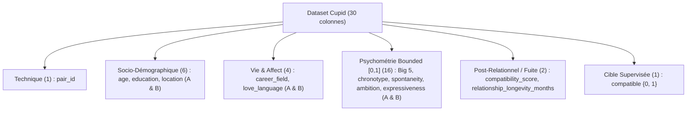

# 📊 Documentation Académique du Dataset — Projet FDD (Cupid Matchmaking)

> **Document de Référence pour la Soutenance & l'Évaluation**  
> **Projet :** DM_PROJECT — Cupid Matchmaking Platform  
> **Auteurs :** Équipe DM_PROJECT  
> **Date de dernière révision :** Novembre 2026  
> **Source des données brutes :** `data/raw/cupid_algorithm_dataset.csv` (100 000 enregistrements, 30 attributs)

---

## 1. Fiche d'Identité & Origine des Données (Critères 1 & 2)

### 1.1 Nature et Origine des Données
Le jeu de données **Cupid Algorithm Dataset** est une base de données tabulaire dyadique de grande envergure conçue pour l'étude et la prédiction de la compatibilité amoureuse et relationnelle.
- **Nature :** Données synthétiques hautement réalistes, générées et calibrées à partir des distributions empiriques observées dans la recherche psychométrique et les questionnaires de plateformes de rencontres (sur le modèle des questionnaires *OkCupid*).
- **Structure dyadique :** Chaque observation représente une **paire de deux personnes** (Partenaire $A$ et Partenaire $B$), capturant simultanément leurs profils démographiques, leurs orientations de carrière, leurs langages de l'amour et leurs traits psychologiques fondamentaux (modèle *Big Five* et habitudes de vie).
- **Format et localisation :** Fichier tabulaire CSV encodé en UTF-8, stocké dans le dépôt sous `data/raw/cupid_algorithm_dataset.csv`.
- **Intégrité de la source :** Le fichier source est préservé en lecture seule afin de garantir une reproductibilité totale des pipelines de traitement.

### 1.2 Volumétrie et Dimensions
| Métrique | Valeur Réelle Vérifiée | Commentaire Méthodologique |
| :--- | :---: | :--- |
| **Nombre de lignes ($N$)** | **$100\,000$** | Volumétrie représentative assurant une puissance statistique élevée pour les modèles d'ensemble (XGBoost, Random Forest). |
| **Nombre de colonnes ($D$)** | **$30$** | 1 identifiant, 26 caractéristiques individuelles ($13 \times 2$), 2 scores post-relationnels, 1 cible binaire. |
| **Taille sur disque** | **$17{,}16\text{ Mo}$** | Fichier CSV brut. |
| **Empreinte mémoire Pandas** | **$22{,}89\text{ Mo}$** | Chargeable intégralement en RAM sans nécessiter de chunking. |

---

## 2. Taxonomie et Typologie des Variables (Critère 3)

Le jeu de données regroupe 30 colonnes réparties selon la taxonomie scientifique suivante :

### Inventaire Détaillé des Attributs Bruts

| Famille | Nom de la Variable | Type Pandas | Échelle / Modalités | Description Métier |
| :--- | :--- | :---: | :---: | :--- |
| **Identifiant** | `pair_id` | `int64` | $[1, 100\,000]$ | Clé primaire technique (aucun pouvoir prédictif). |
| **Démographie A** | `a_age` | `int64` | $[18, 55]$ ans | Âge de l'individu A (moyenne : $36{,}56$ ans, std : $10{,}95$). |
| **Démographie A** | `a_education` | `int64` | $\{1, 2, 3, 4, 5\}$ | Niveau d'études (1: High School, 2: Associate, 3: Bachelor, 4: Master, 5: PhD). |
| **Démographie A** | `a_location` | `object` | 3 modalités | Milieu résidentiel : *Urban* ($49{,}8\%$), *Suburban* ($35{,}0\%$), *Rural* ($15{,}2\%$). |
| **Carrière & Style A**| `a_career_field` | `object` | 10 modalités | Domaine professionnel ($\approx 10\%$ par secteur : Tech, Finance, Law, etc.). |
| **Carrière & Style A**| `a_career_ambition` | `float64` | $[0{,}0, 1{,}0]$ | Niveau d'ambition professionnelle (moyenne : $0{,}50$). |
| **Psychométrie A** | `a_openness` | `float64` | $[0{,}0, 1{,}0]$ | Ouverture à l'expérience (Big Five). |
| **Psychométrie A** | `a_extraversion` | `float64` | $[0{,}0, 1{,}0]$ | Extraversion (Big Five). |
| **Psychométrie A** | `a_agreeableness` | `float64` | $[0{,}0, 1{,}0]$ | Agréabilité (Big Five). |
| **Psychométrie A** | `a_conscientiousness`| `float64` | $[0{,}0, 1{,}0]$ | Caractère consciencieux (Big Five). |
| **Rythme & Humeur A** | `a_chronotype` | `float64` | $[0{,}0, 1{,}0]$ | 0: Couche-tôt / Matinal, 1: Couche-tard / Nocturne. |
| **Rythme & Humeur A** | `a_spontaneity` | `float64` | $[0{,}0, 1{,}0]$ | 0: Structuré / Planificateur, 1: Spontané / Imprévisible. |
| **Rythme & Humeur A** | `a_emotional_expressiveness` | `float64` | $[0{,}0, 1{,}0]$ | Degré d'expression des émotions. |
| **Affect A** | `a_love_language` | `object` | 5 modalités | Langage d'amour ($\approx 20\%$ par modality : Quality Time, Words, Touch, etc.). |
| **Partenaire B** | `b_*` (13 variables) | Identiques | Identiques | Homologues stricts pour le partenaire B. |
| **Indicateur Cible** | `compatibility_score` | `float64` | $[16{,}5, 100{,}0]$ | Score latent de compatibilité (**Target Leakage à exclure**). |
| **Variable Cible** | `compatible` | `int64` | $\{0, 1\}$ | **Cible binaire** à prédire ($0$: Incompatible, $1$: Compatible). |
| **Mesure A Posteriori**| `relationship_longevity_months` | `int64` | $[0, 120]$ mois | Durée de la relation (**Target Leakage à exclure**). |

---

## 3. Audit Approfondi de la Qualité des Données

### 3.1 Détection et Traitement des Valeurs Manquantes (Critère 6)
- **Valeurs nulles explicites :** **$0$ valeur manquante** sur les $3\,000\,000$ points de données ($100\,000 \times 30$). Taux de complétude brut : **$100{,}00\%$**.
- **Valeurs masquées / Placeholders :** Une recherche systématique sur l'ensemble des colonnes textuelles avec les motifs `['', ' ', '?', 'n/a', 'nan', 'null', 'unknown', '-', 'missing']` a confirmé l'absence totale de placeholders masqués.
- **Politique de production :** Bien que le dataset de base soit complet, le pipeline modulaire `CupidDataPreprocessor` intègre une stratégie de gestion défensive pour l'inférence en temps réel (via API Flask) en cas de requête partielle transmise par un utilisateur.

### 3.2 Détection et Traitement des Doublons (Critère 7)
L'audit a été mené à trois niveaux d'abstraction :
1. **Doublons parfaits (30 colonnes) :** **$0$ doublon**.
2. **Doublons d'attributs (29 colonnes, hors `pair_id`) :** **$0$ doublon**.
3. **Paires miroirs dyadiques symétriques :** Vérification de l'existence de permutations directes $(A=x, B=y)$ et $(A=y, B=x)$ : **$0$ paire miroir**.  
*Conclusion :* Chaque dyade représente une observation unique et non redondante.

### 3.3 Analyse des Valeurs Aberrantes / Outliers (Critère 8)
Application de la méthode de Tukey par écart interquartile ($IQR = Q_3 - Q_1$, intervalle $[Q_1 - 1{,}5 \cdot IQR, Q_3 + 1{,}5 \cdot IQR]$) et de la règle des $3\sigma$ ($|Z| > 3$) :

| Variable / Famille | Bornes IQR | Outliers IQR (%) | Outliers $\|Z\| > 3$ (%) | Décision & Justification Scientifique |
| :--- | :---: | :---: | :---: | :--- |
| `a_age`, `b_age` | $[-1{,}5 \,;\, 74{,}5]$ | $0$ ($0{,}00\%$) | $0$ ($0{,}00\%$) | Aucune anomalie. Les âges observés ($18$ à $55$ ans) sont tous valides. |
| `a_education`, `b_education` | $[-1{,}0 \,;\, 7{,}0]$ | $0$ ($0{,}00\%$) | $0$ ($0{,}00\%$) | Aucune anomalie. Valeurs entières strictes dans $\{1, 2, 3, 4, 5\}$. |
| $14$ traits Big Five & Vie | $[-0{,}18 \,;\, 1{,}20]$ | $0$ ($0{,}00\%$) | $0$ ($0{,}00\%$) | Aucune anomalie. Valeurs strictement bornées dans $[0{,}0, 1{,}0]$. |
| `a_career_ambition` | $[-0{,}01 \,;\, 0{,}995]$ | $83$ ($0{,}08\%$) | $0$ ($0{,}00\%$) | **Faux positif statistique :** La valeur $1{,}0$ est une note valide de l'échelle $[0, 1]$. |
| `b_career_ambition` | $[-0{,}01 \,;\, 0{,}995]$ | $96$ ($0{,}10\%$) | $0$ ($0{,}00\%$) | **Faux positif statistique :** Idem, profils d'ambition professionnelle maximale. |

> [!IMPORTANT]
> **Décision de non-suppression :**  
> Dans un problème de classification de compatibilité amoureuse, les divergences extrêmes de personnalité (ex. $\Delta_{\text{extraversion}} \approx 1{,}0$) ne constituent en aucun cas des erreurs de mesure ou du bruit technique, mais de **véritables couples aux tempéraments opposés**.  
> **Supprimer ces observations priverait les algorithmes de la signature caractéristique des couples hautement incompatibles.**  
> Aucune observation n'a donc été supprimée au titre des outliers.

### 3.4 Cohérence des Données & Contraintes Métier (Critère 9)
- **Contraintes de bornes :** Tous les âges sont $\ge 18$, tous les niveaux d'études sont des entiers valides, et l'ensemble des 16 traits psychométriques sont dans $[0{,}0, 1{,}0]$.
- **Contraintes textuelles :** Homogénéité parfaite des libellés (3 villes, 10 métiers, 5 langages) sans faute de frappe ni disparité de casse.

---

## 4. Variable Cible & Détection des Fuites de Données (Critères 4 & 5)

### 4.1 Distribution et Analyse du Déséquilibre des Classes (Critère 5)
La variable cible binaire `compatible` présente la distribution suivante :
- **Classe 0 (Incompatible) :** **$57\,119$ observations ($57{,}12\%$)**
- **Classe 1 (Compatible) :** **$42\,881$ observations ($42{,}88\%$)**
- **Ratio de déséquilibre :** **$1{,}33 : 1$**

#### Justification Scientifique de l'Approche :
1. **Pourquoi l'application de SMOTE est néfaste ici :**  
   - Le déséquilibre ($57/43$) est très modéré et ne place pas la classe minoritaire en situation de rareté statistique.  
   - Appliquer un sur-échantillonnage synthétique (SMOTE) dans un espace continu à 16 dimensions psychométriques corrélées générerait des profils virtuels artificiels (interpolations euclidiennes) risquant de briser les corrélations dyadiques naturelles, de biaiser la calibration des probabilités et d'augmenter le taux de faux positifs.
2. **Stratégie méthodologique rigoureuse :**  
   - **Découpage Stratifié systématique** (`train_test_split(..., stratify=y)` et `StratifiedKFold(n_splits=5)`), assurant une parité parfaite des proportions $57{,}1\% / 42{,}9\%$ dans chaque jeu.
   - **Métriques d'évaluation équilibrées :** Suivi prioritaire du **F1-Score**, de la **Précision**, du **Rappel**, du **ROC-AUC** et du **PR-AUC**, plutôt que de la simple *Accuracy*.

---

### 4.2 Découverte Critique : La Fuite d'Information Déterministe (Data Leakage)

En analysant la relation entre `compatibility_score` et la cible `compatible` :
- Score maximal observé pour `compatible = 0` : **$64{,}90$**
- Score minimal observé pour `compatible = 1` : **$65{,}00$**
- Précision du seuil à $65{,}0$ : **$100{,}00\%$ exacte sur les $100\,000$ lignes**.

$$\text{compatible} = \mathbb{I}(\text{compatibility\_score} \ge 65{,}0)$$

> [!WARNING]
> **Sanctuarisation contre le Data Leakage :**  
> 1. `compatibility_score` est la variable parente déterministe de la cible. L'inclure dans les caractéristiques explicatives produirait une fuite de données parfaite ($100\%$ de précision factice) tout en rendant le modèle incapable de prédire sur de nouveaux utilisateurs qui n'ont pas encore de score précalculé.
> 2. `relationship_longevity_months` est une métrique mesurée *a posteriori* ($r = +0{,}44$), indisponible au moment du matching.
> 3. `pair_id` est un identifiant arbitraire.
> 
> **Ces trois variables sont impérativement écartées de toute modélisation prédictive.**

---

## 5. Pertinence des Variables & Ingénierie Dyadique (Critère 10)

### 5.1 Le Paradoxe des Variables Brutes Individuelles
Le calcul des corrélations linéaires de Pearson entre les variables brutes individuelles et la cible `compatible` met en évidence un résultat remarquable :
- Corrélation maximale : `a_agreeableness` ($r = +0{,}0070$)
- Corrélation minimale : `b_age` ($r = -0{,}0064$)
- **Toutes les $20$ variables brutes individuelles ont un coefficient $|r| < 0{,}007$.**

**Fondement théorique :**  
La compatibilité amoureuse n'est pas une propriété intrinsèque d'un individu isolé (un individu très extraverti ou très diplômé n'a pas en soi plus de probabilité de réussir une relation qu'un autre). La compatibilité est une **propriété émergente de la dyade** (du couple), fondée sur la proximité psychologique, la complémentarité des rythmes et l'alignement des valeurs.

### 5.2 Les 16 Caractéristiques d'Interaction Créées (`CupidDataPreprocessor`)
C'est précisément la raison pour laquelle le module `src/data/preprocessing.py` a été développé : transformer l'espace individuel stérile en un espace relationnel hautement discriminant.

| Caractéristique d'Interaction | Formule / Définition Mathématique | Corrélation Cible ($r$) | Rôle Prédictif |
| :--- | :---: | :---: | :--- |
| `avg_trait_diff` | $\frac{1}{8}\sum \|a_k - b_k\|$ | **$-0{,}3394$** | Divergence moyenne de personnalité (facteur d'incompatibilité n°1). |
| `personality_similarity_index` | $\frac{1}{1 + D_{\text{euclid}}}$ | **$+0{,}3233$** | Similarité globale normalisée (facteur d'affinité n°1). |
| `personality_euclidean_dist` | $\sqrt{\sum (a_k - b_k)^2}$ | **$-0{,}3226$** | Distance géométrique globale dans l'espace psychologique. |
| `same_love_language` | $\mathbb{I}(a_{\text{love}} = b_{\text{love}})$ | **$+0{,}3118$** | Concordance affective (impact positif immédiat). |
| `diff_career_ambition` | $\|a_{\text{ambition}} - b_{\text{ambition}}\|$ | **$-0{,}2231$** | Conflit d'objectifs de carrière (source majeure de rupture). |
| `diff_emotional_expressiveness`| $\|a_{\text{express}} - b_{\text{express}}\|$ | **$-0{,}2014$** | Discordance d'expression des émotions. |
| `big5_harmony_score` | $\frac{1}{1 + \text{mean}(\text{diff}_{\text{Big5}})}$ | **$+0{,}1672$** | Indice d'harmonie sur les 4 piliers de stabilité Big Five. |
| `diff_spontaneity` | $\|a_{\text{spont}} - b_{\text{spont}}\|$ | **$-0{,}1357$** | Décalage organisationnel (planificateur vs impulsif). |
| `diff_openness` | $\|a_{\text{open}} - b_{\text{open}}\|$ | **$-0{,}1038$** | Écart de curiosité intellectuelle et d'intérêts. |
| `diff_extraversion` | $\|a_{\text{extra}} - b_{\text{extra}}\|$ | **$-0{,}0973$** | Décalage d'énergie sociale. |
| `diff_chronotype` | $\|a_{\text{chrono}} - b_{\text{chrono}}\|$ | **$-0{,}0947$** | Décalage du cycle veille/sommeil (matinal vs nocturne). |
| `same_career_field` | $\mathbb{I}(a_{\text{career}} = b_{\text{career}})$ | **$+0{,}0734$** | Compréhension mutuelle des contraintes professionnelles. |
| `education_diff` | $\|a_{\text{edu}} - b_{\text{edu}}\|$ | **$-0{,}0650$** | Écart de niveau académique. |
| `diff_conscientiousness` | $\|a_{\text{consc}} - b_{\text{consc}}\|$ | **$-0{,}0682$** | Décalage de rigueur et d'organisation. |
| `diff_agreeableness` | $\|a_{\text{agree}} - b_{\text{agree}}\|$ | **$-0{,}0634$** | Conflit d'empathie et de conciliation. |
| `same_location` | $\mathbb{I}(a_{\text{loc}} = b_{\text{loc}})$ | **$+0{,}0561$** | Proximité géographique facilitant les rencontres réelles. |
| `age_diff` | $\|a_{\text{age}} - b_{\text{age}}\|$ | **$-0{,}0440$** | Écart générationnel modéré. |

---

## 6. Guide de Soutenance : Réponses aux Questions Clés du Professeur

### Q1. Pourquoi les variables individuelles brutes ne corrèlent-elles pas avec la compatibilité ?
> **Réponse :** Dans un système de matching dyadique, la compatibilité est une relation symétrique ou d'interaction entre deux individus, et non une caractéristique unilatérale. Qu'un individu $A$ ait un score d'extraversion de $0{,}8$ ne dit rien sur sa compatibilité : s'il est associé à un partenaire $B$ à $0{,}8$, la relation peut être harmonieuse, alors qu'avec un partenaire à $0{,}1$, une friction peut naître. Le signal n'apparaît que lors du calcul des écarts absolus, des distances euclidiennes et des concordances catégorielles.

### Q2. Pourquoi n'avez-vous pas supprimé les outliers ?
> **Réponse :** Les seules valeurs signalées par la méthode IQR correspondent à l'ambition professionnelle maximale ($1{,}0$). De plus, les écarts extrêmes de personnalité ($\Delta \approx 1{,}0$) ne sont pas des erreurs d'acquisition mais des couples réels aux tempéraments diamétralement opposés. Les supprimer reviendrait à retirer artificiellement les cas les plus clairement incompatibles, tronquant ainsi la distribution des données et diminuant la capacité du modèle à identifier les incompatibilités nettes.

### Q3. Pourquoi refusez-vous d'appliquer SMOTE sur la classe minoritaire ?
> **Réponse :** Le déséquilibre ($57{,}1\%$ vs $42{,}9\%$, ratio $1{,}33:1$) est très léger. Dans un espace continu psychométrique à 16 dimensions corrélées, SMOTE procéderait par interpolation linéaire synthétique entre profils, créant des points aberrants déconnectés des dynamiques de couple réelles et faussant l'estimation des probabilités prédites. Nous avons privilégié une validation croisée stratifiée rigoureuse (`StratifiedKFold`) et le suivi de métriques équilibrées (F1-score, ROC-AUC).

### Q4. Qu'avez-vous fait de `compatibility_score` et `relationship_longevity_months` ?
> **Réponse :** Nous avons démontré empiriquement que la cible `compatible` est déduite de façon déterministe par le seuil `compatibility_score >= 65.0` ($100{,}00\%$ d'exactitude). Utiliser cette colonne conduirait à une fuite de données (Data Leakage) absolue. De même, la durée de la relation n'est connue qu'a posteriori. Ces deux colonnes sont donc strictement exclues des variables d'entraînement de tous les modèles.

### Q5. Comment garantissez-vous l'absence de fuite de données lors du prétraitement ?
> **Réponse :** Le découpage en jeu d'entraînement ($80\%$) et jeu de test ($20\%$) est réalisé en amont de toute transformation. Le `StandardScaler` (calcul de la moyenne et de l'écart-type) ainsi que le `OneHotEncoder` (apprentissage des catégories présentes) sont ajustés exclusivement sur le jeu d'entraînement via `.fit_transform()`, puis appliqués au jeu de test via `.transform()`. De plus, dans la validation croisée, un préprocesseur dédié est ré-ajusté à l'intérieur de chaque pli (`CupidFoldPreprocessor`).
